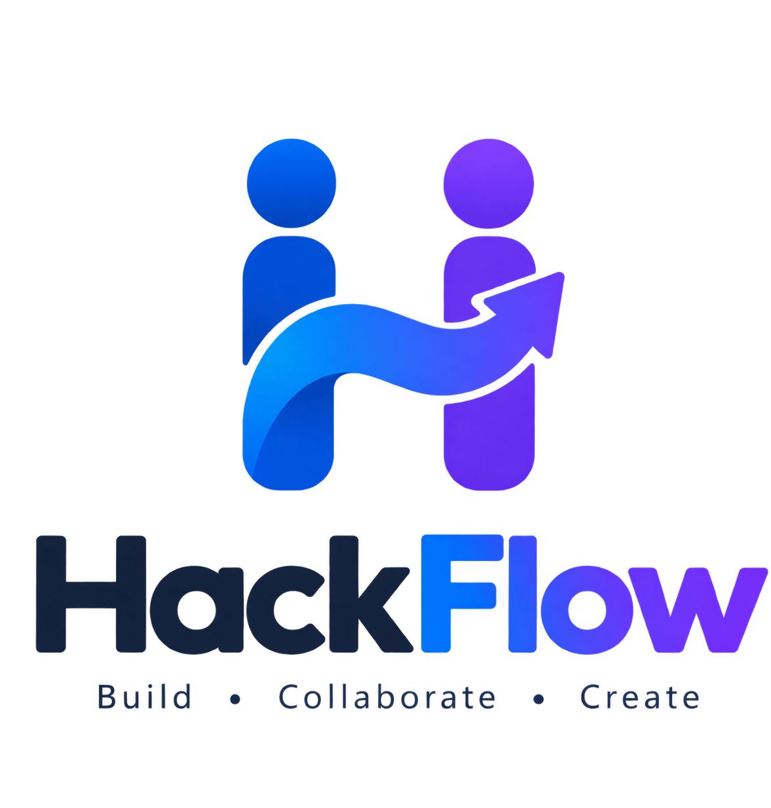

<p align="center">
  
</p>

<h1 align="center">HackFlow</h1>

<p align="center"><strong>Build · Collaborate · Create</strong></p>

<p align="center">
  La plateforme qui aide les équipes étudiantes à transformer une idée en projet de hackathon.
</p>

<p align="center">
  
  
  
</p>

## À propos

HackFlow rassemble dans un même espace les outils utiles pendant un hackathon étudiant : trouver des coéquipiers, partager ses compétences, demander conseil à un mentor et suivre l’avancement d’un projet.

L’expérience s’articule autour de trois espaces — **étudiant**, **mentor** et **organisateur** — afin que chacun retrouve les informations et les actions adaptées à son rôle.

## Ce que propose HackFlow

- **Trouver son équipe** : découvrir des profils complémentaires et mettre en valeur ses compétences.
- **Avancer ensemble** : visualiser les tâches, les jalons et le rendu du projet.
- **Être accompagné** : solliciter un mentor et consulter les demandes d’aide.
- **Organiser l’événement** : suivre les participants, les équipes, les annonces et les évaluations depuis un cockpit dédié.
- **Présenter son profil** : gérer ses informations, sa photo et son CV.
- **Opportunités carrière** : consulter des offres modérées, comprendre le score de correspondance et suivre ses candidatures.

## Trois espaces, un objectif commun

| Étudiants | Mentors | Organisateurs |
|---|---|---|
| Profil et compétences | Suivi des équipes | Vue d’ensemble du hackathon |
| Équipes et matching | Demandes d’accompagnement | Participants et équipes |
| Tâches et rendu du projet | Évaluations et retours | Annonces et notation |

## État du projet

HackFlow est un **prototype web en cours de développement**. La création de compte étudiant ou mentor, la connexion, les rôles, la gestion du profil et les fichiers associés sont reliés à la base de données. Les espaces métier présentent le parcours et l’interface cible ; plusieurs listes reposent encore sur des données d’exemple, et certaines actions affichent une confirmation de démonstration sans enregistrer de données.

Cette version permet de découvrir l’expérience envisagée et constitue une base pour connecter progressivement les équipes, tâches, demandes et évaluations à des données persistantes.

## Aperçu

L’application comprend une page d’accueil publique et des tableaux de bord distincts pour chaque rôle. Pour explorer l’interface localement, consultez le démarrage rapide ci-dessous.

## Démarrage rapide

Prérequis : Python 3.10 ou plus récent.

```bash
git clone https://github.com/MrabetSarra/hackflow_5TWIN4.git
cd hackflow_5TWIN4
python -m venv .venv
# Windows PowerShell: create local settings if they do not exist yet
if (-not (Test-Path .env)) { Copy-Item .env.example .env }
# macOS / Linux: test -f .env || cp .env.example .env
```

Activez l’environnement virtuel, puis installez et lancez le projet :

```bash
# Windows PowerShell
.\.venv\Scripts\Activate.ps1

# macOS / Linux
source .venv/bin/activate

python -m pip install -r requirements.txt
python manage.py migrate
python manage.py runserver
```

Ouvrez [http://127.0.0.1:8000/](http://127.0.0.1:8000/). La base SQLite locale est créée lors de l’application des migrations. L’envoi des codes de réinitialisation du mot de passe nécessite une configuration SMTP Gmail.

### Configuration du copilote IA local

Le copilote admin utilise Ollama en local. Installez Ollama, téléchargez le modèle par défaut, puis démarrez le serveur Ollama :

```powershell
ollama pull qwen2.5:7b
ollama serve
```

Le serveur Django se connecte par défaut à `http://127.0.0.1:11434`. `OLLAMA_BASE_URL` et `OLLAMA_COPILOT_MODEL` permettent de modifier l'adresse et le modèle du copilote. Le matching des équipes utilise un score pondéré calculé par Django ; ses propositions restent en attente de validation par l'organisateur.

### AI Team Formation

Les organisateurs lancent une proposition depuis la page Participants. Le score pondéré compare les compétences demandées et complémentaires, les rôles, les thèmes préférés, les disponibilités déclarées et la capacité des équipes. Les étudiants peuvent renseigner leurs rôles, thèmes et disponibilités dans leur profil (`/accounts/profile/?edit=1`). Les propositions expliquent les apports de chaque membre et les rôles ou compétences encore absents ; aucune affectation n'est enregistrée avant validation par l'organisateur. Les préférences et disponibilités sont facultatives et un champ vide reste neutre.

### AI Hackathon Copilot

Le copilote est intégré au cockpit organisateur (`/cockpit/`). Ses compteurs, risques d'échéance et listes de projets sont calculés par Django depuis la base ; Ollama génère uniquement l'explication et les recommandations. Les annonces générées peuvent être modifiées puis enregistrées comme brouillons ; elles ne sont jamais publiées automatiquement. Le modèle peut être réglé séparément via `OLLAMA_COPILOT_MODEL`.

### AI Project Evaluation Assistant

La page Jury (`/cockpit/judging/`) permet à l'organisateur de demander une analyse Ollama des soumissions réelles. L'assistant résume le projet, relève objectifs, technologies et cas d'usage, confronte les éléments visibles à la grille et propose des questions. Pour un ZIP, seuls les petits fichiers texte de présentation et manifestes connus sont lus localement, sans extraction. L'assistant n'attribue aucune note et ne classe ni ne désigne de gagnant ; la décision appartient au jury.

## Technologies

- **Backend :** Python et Django
- **Données locales :** SQLite
- **Interface :** Django Templates, Bootstrap, CSS et JavaScript
- **Médias :** Pillow pour la photo de profil ; CV conservés dans un stockage privé local

## Career opportunities

Students browse opportunities at `/careers/`. Organizers publish and manage offers at `/cockpit/careers/`; offers are entered directly by organizers, and external applications link to the employer.

### Organizer-published offers and CV matching

Organizers create offers at `/cockpit/careers/new/`. New manual offers start as drafts; the status control supports publishing and archiving. The editor provides a live preview, explicit required/preferred skills, education, experience, languages, location/work-arrangement requirements, and project/other eligibility criteria. Skill weights use `Skill=weight` entries (for example `Python=25, SQL=15`). All positive weights are validated from 0 to 100 and normalized to exactly 100 when saved.

Student matching uses the existing private profile PDF and existing profile fields. `pdfminer.six` extracts selectable text, while PyMuPDF and RapidOCR run local OCR on scanned pages when needed. Processing is limited to 10 MB and 20 pages. Install dependencies with `python -m pip install -r requirements.txt`; OCR runs on the same machine and sends no CV content to an external service. Raw extracted text is not stored; structured evidence snippets and their timestamp are cached by the CV's SHA-256 digest. Missing or unreadable evidence does not produce a compatibility percentage.

Each explicit requirement receives an evidence-based match percentage or an unknown state. The overall score is `sum(match_pct × weight) / sum(weights for requirements with reliable evidence)`. Profile coverage is evaluated requirement weight divided by all positive requirement weight. Scores are hidden below 30% coverage to avoid false precision. Explicit mandatory contradictions are shown separately; missing CV evidence remains unverified rather than being treated as proof that a student lacks a skill. Per-student/per-offer result caches are invalidated by CV, profile or offer changes. Students see only published offers whose publication date has arrived and whose deadline has not passed.

Apply the additive schema changes with `python manage.py migrate`. Run `python manage.py check` and `python manage.py test career_opportunities` to verify the career module.

## AI task generation

AI task suggestions reuse the repository AI provider configuration. Set `REPOSITORY_AI_PROVIDER` to `ollama`, `openai`, or `anthropic`; configure `OLLAMA_BASE_URL` and `OLLAMA_MODEL` for Ollama, `OPENAI_API_KEY` and `OPENAI_MODEL` for OpenAI, or `ANTHROPIC_API_KEY` and `ANTHROPIC_MODEL` for Anthropic. `REPOSITORY_AI_TIMEOUT` controls provider timeouts.

For background processing, set `CELERY_BROKER_URL` (default: `redis://localhost:6379/0`) and `CELERY_TASK_ALWAYS_EAGER` (`true` runs jobs synchronously; it defaults to the Django `DEBUG` value). Set `CELERY_TASK_ALWAYS_EAGER=false` when using a worker. Start it with:

```bash
celery -A hackflow worker -l info
```

Run `python manage.py evaluate_ai` for reproducible mocked metrics, or add `--live` to call the configured AI provider. The report is written to `reports/ai_metrics.md`.

## Organisation du dépôt

```text
accounts/          Comptes, rôles et profils
core/              Page publique
student/           Espace étudiant
mentor/            Espace mentor
dashboard_admin/   Espace organisateur
templates/         Pages et layouts
static/             Styles, scripts et identité visuelle
```

## Pistes d’évolution

- Remplacer les données d’exemple par des modèles métier persistants.
- Connecter les actions de gestion des équipes, tâches et demandes.
- Ajouter des tests couvrant les parcours de compte et les permissions par rôle.

---

**HackFlow — Build · Collaborate · Create**

## Testing and coverage

Install the development dependencies and run the full Django suite:

```bash
python -m pip install -r requirements-dev.txt
python manage.py test
```

For local Windows PowerShell, set a development key before running Django commands if your `.env` has `DJANGO_DEBUG=false`:

```powershell
$env:DJANGO_DEBUG = 'true'
$env:DJANGO_SECRET_KEY = 'local-test-key-change-me'
python manage.py test
```

In Windows PowerShell, generate a fresh coverage report with:

```powershell
$env:DJANGO_DEBUG = "true"
python -m coverage erase
python -m coverage run manage.py test
if ($LASTEXITCODE -ne 0) { throw "Django tests failed; do not use this coverage report." }
python -m coverage report
python -m coverage xml -o coverage.xml
python -m coverage html
```

The HTML report is written to `htmlcov/`; `coverage.xml` is the Cobertura report read by SonarQube. Coverage uses relative file paths so the report can be imported when the scanner runs in Docker. CI enforces 80% coverage and uploads both reports. Sonar analysis runs locally against the local SonarQube server; the GitHub Actions workflow does not submit analysis to SonarQube Cloud.

For a local SonarQube server on port 9000, activate the virtual environment, create the `HackFlow` project in SonarQube, then generate a fresh report and run the scanner from the repository root:

```powershell
coverage erase
coverage run manage.py test
coverage xml -o coverage.xml

$env:SONAR_HOST_URL = 'http://host.docker.internal:9000'
$secureToken = Read-Host 'Local SonarQube token' -AsSecureString
$env:SONAR_TOKEN = [System.Net.NetworkCredential]::new('', $secureToken).Password

docker run --rm `
  --workdir /usr/src `
  -e SONAR_HOST_URL `
  -e SONAR_TOKEN `
  -v "${PWD}:/usr/src" `
  sonarsource/sonar-scanner-cli `
  -Dsonar.projectBaseDir=/usr/src `
  -Dsonar.verbose=true

Remove-Item Env:SONAR_TOKEN
Remove-Variable secureToken
```

## Environment variables

Copy `.env.example` to `.env` and set the values for your environment:

- Django: `DJANGO_DEBUG`, `DJANGO_SECRET_KEY`, `DJANGO_ALLOWED_HOSTS`.
- Production security: `SESSION_COOKIE_SECURE`, `CSRF_COOKIE_SECURE`, `SECURE_SSL_REDIRECT`, `SECURE_HSTS_SECONDS`, `SECURE_HSTS_INCLUDE_SUBDOMAINS`, `SECURE_HSTS_PRELOAD`, `SECURE_CONTENT_TYPE_NOSNIFF`, `X_FRAME_OPTIONS`, `SECURE_PROXY_SSL_HEADER`, and `CSRF_TRUSTED_ORIGINS`.
- Email: `EMAIL_HOST`, `EMAIL_PORT`, `EMAIL_USE_TLS`, `EMAIL_HOST_USER`, `EMAIL_HOST_PASSWORD`, `DEFAULT_FROM_EMAIL`. The console backend is used unless both SMTP credentials are set.
- GitHub repository hosting: `GITHUB_TOKEN`, `GITHUB_OWNER`, and optional `GITHUB_PRIVATE_REPOSITORIES`.
- Local repository cache/staging: `HACKFLOW_REPOS_ROOT` (disposable; GitHub stores durable repository history).
- AI providers: `REPOSITORY_AI_PROVIDER`, `REPOSITORY_AI_TIMEOUT`, `OLLAMA_BASE_URL`, `OLLAMA_MODEL`, `OPENAI_API_KEY`, `OPENAI_MODEL`, `ANTHROPIC_API_KEY`, `ANTHROPIC_MODEL`.
- Background jobs: `CELERY_BROKER_URL`, `CELERY_TASK_ALWAYS_EAGER`.

When `DJANGO_DEBUG=false`, Django refuses to start without `DJANGO_SECRET_KEY`. Never use `*` for allowed hosts. HTTPS and proxy values must match the hosting provider's configuration.

## Security checklist

- Keep `.env`, the local SQLite database, logs, and `.repository-data/` out of Git.
- Use a long, unique production secret key and keep debug mode disabled.
- Set exact allowed hosts and CSRF trusted origins for the deployed domain.
- Enable HTTPS cookie protection and redirects when TLS is terminated by the application; configure the trusted proxy header only when the host guarantees it.
- Configure SMTP credentials through environment variables; use a restricted mail account.
- Review `python manage.py check --deploy` before deployment. HSTS preload is opt-in and should only be enabled when the domain is ready for permanent browser preload behavior.

## Deployment

### Architecture

Render runs one native Python web service from the `main` branch. The Blueprint pins Python 3.12.11, collects static files, starts Django with Gunicorn through `scripts/start.sh`, and uses `/healthz/` for its health check. WhiteNoise serves static files. GitHub Actions is the deployment controller: a successful CI run on `main` triggers the Render Deploy Hook, waits for health, and runs the smoke checks. The app logs to stdout.

The service uses SQLite and the free Render filesystem. `DATABASE_PATH` and the local Git cache are under `/tmp` and are ephemeral. Cloudinary stores uploaded media: profile photos use public image delivery, while CVs, submission ZIPs, and team documents use authenticated delivery through permission-checked Django views. **The free Render instance still resets database records on restart and re-seeds demo data at startup** (`SEED_DEMO=1`). Cloudinary preserves media files, but it does not preserve database records. Celery runs eagerly in the web process because this deployment has no background worker.

### Environment variables

The complete example is in `.env.production.example`. Configure the following values in Render; values marked **secret** must be stored in Render’s environment settings and must never be committed.

| Variable | Render value or source | Purpose |
| --- | --- | --- |
| `PYTHON_VERSION` | `3.12.11` | Native runtime version. |
| `DJANGO_DEBUG` | `false` | Production mode. |
| `DJANGO_SECRET_KEY` | **Secret** | Required Django signing key. |
| `DJANGO_ALLOWED_HOSTS` | `esprit-5twin4-Hackflow.onrender.com` | Hostnames accepted by Django. |
| `CSRF_TRUSTED_ORIGINS` | `https://esprit-5twin4-HackFlow.onrender.com` | Trusted browser origin. |
| `SECURE_SSL_REDIRECT` | `true` | Redirect HTTP to HTTPS. |
| `SESSION_COOKIE_SECURE`, `CSRF_COOKIE_SECURE` | `true` | Send cookies only over HTTPS. |
| `SECURE_HSTS_SECONDS` | `31536000` | HSTS duration in seconds. |
| `SECURE_HSTS_INCLUDE_SUBDOMAINS` | `true` | Apply HSTS to subdomains. |
| `SECURE_HSTS_PRELOAD` | `false` | Keep preload opt-in until explicitly reviewed. |
| `SECURE_CONTENT_TYPE_NOSNIFF` | `true` | Add the nosniff response header. |
| `X_FRAME_OPTIONS` | `DENY` | Prevent framing by other sites. |
| `SECURE_PROXY_SSL_HEADER` | `HTTP_X_FORWARDED_PROTO,https` | Trust Render’s HTTPS proxy header. |
| `DATABASE_PATH` | `/tmp/hackflow.sqlite3` | Ephemeral SQLite database file. |
| `MEDIA_ROOT` | `/tmp/media/uploads` | Local development/fallback public media storage; production uses Cloudinary. |
| `PRIVATE_MEDIA_ROOT` | `/tmp/private_media` | Local development/fallback private file storage; production uses authenticated Cloudinary storage. |
| `CLOUDINARY_URL` | **Secret from Cloudinary** | Required in Render for persistent uploaded media. |
| `GITHUB_TOKEN`, `GITHUB_OWNER` | **Secret/configuration** | GitHub server credential and owning user/organization. |
| `GITHUB_PRIVATE_REPOSITORIES` | `true` | Create new GitHub repositories as private by default. |
| `STATIC_ROOT` | `/opt/render/project/src/staticfiles` | `collectstatic` output served by WhiteNoise. |
| `SEED_DEMO` | `1` | Re-create demo data at startup. |
| `CELERY_TASK_ALWAYS_EAGER` | `true` | Run jobs inline; no worker is deployed. |
| `CELERY_BROKER_URL` | `redis://localhost:6379/0` | Unused while eager execution is enabled. |
| `DJANGO_SUPERUSER_USERNAME` | **Secret/configuration** | Optional admin bootstrap username. |
| `DJANGO_SUPERUSER_EMAIL` | **Secret/configuration** | Optional admin bootstrap email. |
| `DJANGO_SUPERUSER_PASSWORD` | **Secret** | Optional admin bootstrap password. |
| `EMAIL_HOST`, `EMAIL_PORT`, `EMAIL_USE_TLS` | `localhost`, `587`, `true` | SMTP connection settings. |
| `EMAIL_HOST_USER`, `EMAIL_HOST_PASSWORD` | **Secret** | Optional SMTP credentials; without both, Django uses its console backend. |
| `DEFAULT_FROM_EMAIL` | `webmaster@localhost` | Sender address when SMTP is configured. |
| `REPOSITORY_AI_PROVIDER` | `openai` | Selected optional AI provider. |
| `REPOSITORY_AI_TIMEOUT` | `30` | Provider request timeout in seconds. |
| `OPENAI_API_KEY` | **Secret** | Optional OpenAI credential. |
| `OPENAI_MODEL` | `gpt-5-mini` | OpenAI model name. |
| `ANTHROPIC_API_KEY` | **Secret** | Optional Anthropic credential. |
| `ANTHROPIC_MODEL` | `claude-haiku-4-5-20251001` | Anthropic model name. |
| `OLLAMA_BASE_URL`, `OLLAMA_MODEL` | Local defaults in the example | Optional local Ollama configuration. |
| `PORT` | Set by Render | Port bound by the startup script. |
| `RENDER_DEPLOY_HOOK_URL` | **GitHub `production` environment secret** | Starts the Render deploy after CI passes. |
| `SITE_URL` | **GitHub `production` environment secret** | Public base URL used for health and smoke checks. |

Render values declared with `sync: false` in `render.yaml` are intentionally entered in Render’s dashboard rather than stored in the repository. Add `CLOUDINARY_URL` from the Cloudinary Console to the Render service's Environment settings. Production startup fails with a clear configuration error if it is missing; local development continues to use filesystem media when it is absent. WhiteNoise continues to serve static files separately. The admin command skips creation when any `DJANGO_SUPERUSER_*` value is missing; it never prints the password.

Profile photos are public profile media. CVs, application CVs, project ZIPs, and uploaded team documents are stored as authenticated Cloudinary raw assets. Their signed delivery is performed server-side only after the existing account, organizer, jury, or team-membership checks; private file URLs are not exposed in templates. Team documents are downloaded through the authenticated `student:download_team_resource` view. Event artwork, team covers, and repository covers are URL-based fields rather than uploaded files, so they continue to use their existing URLs.

Media files uploaded to a previous Render instance may already be gone because the old `/tmp` filesystem was ephemeral. This change does not delete or bulk-migrate any existing media. If an existing image URL fails after enabling Cloudinary, re-upload the original image from its source. Existing private files can be re-uploaded through their existing workflows when their original file is available.

### First deploy

1. Connect the GitHub repository to Render and apply `render.yaml` to the intended web service. Confirm the service name and public hostname match the existing `esprit-5twin4-HackFlow` deployment before applying a Blueprint to an existing service.
2. In Render, set `DJANGO_SECRET_KEY`. Set all three `DJANGO_SUPERUSER_*` values if the deployment needs the configured admin account. Add AI and SMTP credentials only when those integrations are used.
3. In GitHub, create the `production` environment and add `RENDER_DEPLOY_HOOK_URL` and `SITE_URL` as environment secrets. Set `SITE_URL` to the HTTPS public URL, with no required trailing slash.
4. Ensure the `main` branch requires the CI status check. Merge a pull request into `main`; the workflow runs checks and tests before calling the deploy hook, waiting for `/healthz/`, and running `scripts/smoke_test.sh`.

The Blueprint sets Render `autoDeployTrigger: off` to avoid a second, duplicate deploy. As an alternative, use Render’s **After CI Checks Pass** auto-deploy setting and disable the GitHub Actions deploy-hook job. Do not enable both deployment paths at once.

### Update and rollback

Normal update flow: create a feature branch, open a pull request, wait for CI and review, then merge to `main`. The `main` push runs the test job and deploys only after it succeeds. The workflow polls the service for up to five minutes, then runs the curl smoke checks. The CI workflow also uploads an HTML coverage report artifact.

Run the same HTTP smoke checks manually with `sh scripts/smoke_test.sh https://esprit-5twin4-Hackflow.onrender.com` (requires `curl`).

To roll back, open the Render service’s deploy history and redeploy a previously successful commit. A rollback restores code, not ephemeral SQLite or uploaded data; the free instance may re-seed demo records on its next restart.

### Troubleshooting

- **Cold start:** Free services sleep while idle. The first request may take a minute; the deploy job allows five minutes for `/healthz/` to return HTTP 200.
- **Data reset after restart:** This is expected for the database on the free filesystem. Demo rows are re-seeded when `SEED_DEMO=1`; Cloudinary media persists, but database records do not.
- **Media configuration:** Production requires `CLOUDINARY_URL`. Set it in the Render web service Environment settings, redeploy, and upload a new profile photo. Its `profile_photo.url` should point to Cloudinary. Private CVs and team files remain downloadable only through their authorized HackFlow views.
- **Existing image missing:** Cloudinary does not restore files already lost from Render's ephemeral filesystem. Re-upload the original image; database records are retained.
- **Git is unavailable:** Check startup warnings. The app remains available, but repository operations and the optional repository demo seed need the Git executable in the runtime. The demo seed is skipped with a warning if Git is absent.
- **CSRF 403 behind the proxy:** Check that `CSRF_TRUSTED_ORIGINS` contains the exact HTTPS origin and that `SECURE_PROXY_SSL_HEADER` matches Render’s forwarded protocol header.
- **SQLite locked:** The app uses a 20-second SQLite timeout and WAL mode, but a single ephemeral SQLite file is not intended for sustained concurrent writes. Keep background jobs eager and avoid adding a second writer process on this plan.
- **AI unavailable:** AI is optional. Check the selected `REPOSITORY_AI_PROVIDER`, its credential, and startup warnings. Missing credentials or an unreachable provider should not prevent the web service from starting.
- **CI coverage or deployment fails:** Inspect the workflow summary, uploaded `hackflow-coverage-html` artifact, the failing job logs, and Render’s deploy logs. Verify both GitHub `production` secrets are present without printing their values.

### Grading evidence

| Requirement | Evidence |
| --- | --- |
| `DEBUG=False` and production configuration | Render environment plus `render.yaml`; `python manage.py check --deploy` in the CI log. |
| Secrets outside source control | `sync: false` entries in `render.yaml`, GitHub `production` secrets, and `.gitignore` entries for `.env` and the database. |
| CSRF protection | Production security settings and the smoke test’s POST-without-token check. |
| Role access | `tests/test_access_matrix.py` and its CI test result. |
| Custom error pages | `templates/404.html`, `templates/403.html`, `templates/500.html`, and `core/tests.py`. |
| Tests and coverage | CI test count/coverage summary and the uploaded HTML coverage artifact. |
| CI-gated deployment | GitHub Actions `test` then `deploy` jobs and the Render deploy history. |
| Public service health | `https://esprit-5twin4-HackFlow.onrender.com/healthz/` and the post-deploy smoke-test output. |
